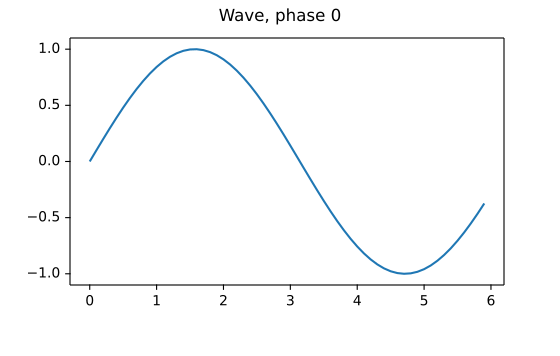

# Animation

> **Install:** `dotnet add package MatPlotLibNet` and `dotnet add package MatPlotLibNet.Skia` for the GIF and PDF export

## AnimationBuilder — an animated GIF from a frame generator

Define a frame generator function and save the result as an animated GIF:

```csharp
using MatPlotLibNet.Animation;
using MatPlotLibNet.Skia;

double[] x = Enumerable.Range(0, 100).Select(i => i * 0.1).ToArray();

var anim = new AnimationBuilder(
    frameCount: 60,
    frameGenerator: i =>
    {
        double t = i / 60.0 * 2 * Math.PI;
        double[] y = x.Select(v => Math.Sin(v + t)).ToArray();
        return Plt.Create()
            .WithTitle($"Frame {i + 1}/60")
            .WithTheme(Theme.Dark)
            .AddSubPlot(1, 1, 1, ax => ax
                .Plot(x, y, s => { s.Color = Colors.Cyan; s.LineWidth = 2; })
                .SetYLim(-1.5, 1.5))
            .Build();
    })
{
    Interval = TimeSpan.FromMilliseconds(50),  // 50 ms between frames = 20 FPS
};

anim.SaveGif("wave.gif");
```

## Animation with theme and styling

```csharp
var anim = new AnimationBuilder(
    frameCount: 30,
    frameGenerator: i =>
    {
        double angle = i * 12;  // rotate 12° per frame
        return Plt.Create()
            .WithTheme(Theme.Cyberpunk)
            .WithSize(600, 600)
            .AddSubPlot(1, 1, 1, ax => ax
                .Surface(x, y, z, s => { s.ColorMap = ColorMaps.Plasma; s.Alpha = 0.9; })
                .WithCamera(elevation: 30, azimuth: -60 + angle))
            .Build();
    })
{
    Interval = TimeSpan.FromMilliseconds(80),  // 80 ms = about 12.5 FPS
};

anim.SaveGif("rotating_surface.gif");
```

## Save individual frames as PNG

Export each frame as a numbered PNG file:

```csharp
anim.SaveFrames("frames/", prefix: "wave");
// Creates: frames/wave_0001.png, frames/wave_0002.png, ...
```

## Multi-page PDF report

Combine multiple charts into a single PDF document:

```csharp
var figures = new[]
{
    Plt.Create()
        .WithTitle("Page 1 — Line Chart")
        .AddSubPlot(1, 1, 1, ax => ax
            .Plot(x, y1, s => s.Label = "Revenue")
            .WithLegend())
        .Build(),

    Plt.Create()
        .WithTitle("Page 2 — Distribution")
        .AddSubPlot(1, 1, 1, ax => ax
            .Hist(data, 30, s => s.Color = Colors.Teal))
        .Build(),

    Plt.Create()
        .WithTitle("Page 3 — Heatmap")
        .AddSubPlot(1, 1, 1, ax => ax
            .Heatmap(matrix)
            .WithColorMap("viridis")
            .WithColorBar())
        .Build(),
};

new PdfTransform().TransformMultiPage(figures, "report.pdf");
```

## Practical example: growing bar chart

```csharp
string[] categories = ["A", "B", "C", "D", "E"];
double[] finalValues = [42, 28, 65, 31, 53];

var anim = new AnimationBuilder(
    frameCount: 40,
    frameGenerator: i =>
    {
        double progress = (i + 1.0) / 40;
        double[] current = finalValues.Select(v => v * progress).ToArray();
        return Plt.Create()
            .WithTitle($"Growth ({progress:P0})")
            .AddSubPlot(1, 1, 1, ax => ax
                .Bar(categories, current, s => s.Color = Colors.Tab10Blue)
                .SetYLim(0, 70)
                .WithBarLabels("F0"))
            .Build();
    })
{
    Interval = TimeSpan.FromMilliseconds(60),
};

anim.SaveGif("growing_bars.gif");
```

## One SVG that steps through its frames

A GIF needs an image viewer that animates it. `SaveStepThroughSvg` writes every frame into one SVG file that carries its own slider, a
play button and the arrow keys, and needs no server and no player:

```csharp
using MatPlotLibNet;
using MatPlotLibNet.Animation;

double[] times = [.. Enumerable.Range(0, 60).Select(i => i * 0.1)];

var waveSteps = new AnimationBuilder(frameCount: 8, frame =>
    Plt.Create()
        .WithTitle($"Wave, phase {frame}")
        .WithSize(560, 320)
        .Plot(times, [.. times.Select(v => Math.Sin(v + frame * 0.4))])
        .Build())
{
    Interval = TimeSpan.FromMilliseconds(400),
    Loop = true,
};

waveSteps.SaveStepThroughSvg("wave_steps.svg");
```



Without its script the file is its first frame, which is what an ``, a README or a viewer that runs nothing shows, and a reader who
asked their system for reduced motion gets no autoplay. Open the file itself to step: Home and End go to the ends, the space bar plays and
pauses, and a click on the track goes to that frame. The file is as large as all its frames together: no frame is dropped or shared.
The SVG and the GIF are written by one contract, `IAnimationTransform` (`StepThroughSvgTransform`, `GifTransform`), which takes the
frames, the time between them, whether it loops, and the stream to write to.

## Fluent API reference

| Class / Method | Parameters | Description |
|---|---|---|
| `new AnimationBuilder(frameCount, frameGenerator)` | count, `Func<int, Figure>` | Create animation; it is an `IAnimation<int>` (the state is the frame index), so `AnimationController<int>`, `InteractiveFigure.AnimateAsync` and the native controls play it as it is |
| `anim.Interval`, `anim.Loop` | `TimeSpan`, `bool` | Time between frames (50 ms by default), whether it loops (by default it does) |
| `anim.SaveGif(path)`, `anim.ToGif()` | `string` | Save as animated GIF, or its bytes |
| `anim.SaveStepThroughSvg(path)`, `anim.ToStepThroughSvg()` | `string` | Save as an SVG that steps through its frames, or its text |
| `anim.SaveFrames(dir, prefix?)` | directory, file prefix | Export individual PNG frames |
| `new PdfTransform().TransformMultiPage(figures, path)` | `Figure[]`, path | Multi-page PDF |

> **Note:** GIF and PNG export requires `MatPlotLibNet.Skia`. PDF export also requires `MatPlotLibNet.Skia`.
