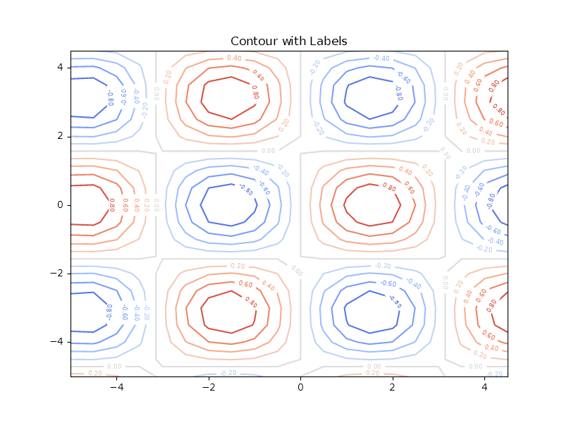
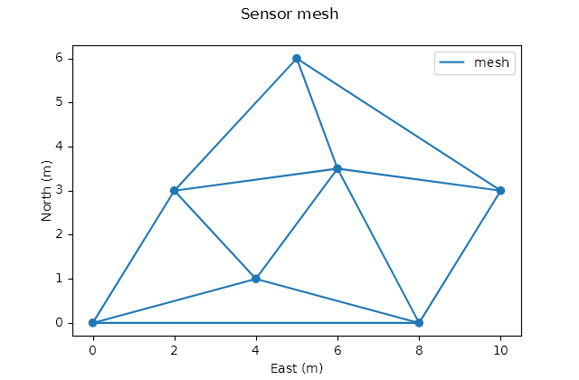

# Contour Plots

> **Install:** `dotnet add package MatPlotLibNet`

## Contour lines with labels

```csharp
double[] x = Enumerable.Range(0, 20).Select(i => i * 0.5 - 5.0).ToArray();
double[] y = Enumerable.Range(0, 20).Select(i => i * 0.5 - 5.0).ToArray();
var z = new double[20, 20];
for (int r = 0; r < 20; r++)
    for (int c = 0; c < 20; c++)
        z[r, c] = Math.Sin(x[c]) * Math.Cos(y[r]);

Plt.Create()
    .AddSubPlot(1, 1, 1, ax => ax
        .WithTitle("Contour with Labels")
        .Contour(x, y, z, s =>
        {
            s.ShowLabels = true;
            s.LabelFormat = "F2";
            s.LabelFontSize = 9;
        })
        .WithColorMap("coolwarm"))
    .Save("contour_labels.svg");
```



Every line is drawn first and every label after them, as matplotlib's `clabel` does, so no line runs across a label. A
label stands at the middle of its line's length, turned along the line and never upside down (it follows an inverted Y
axis too), in the line's colour on a box of the theme's background. A line shorter than 1.2 times its label carries none.
The level is written the same way on every machine, with a point for the decimals whatever the culture.

> **A colour map name is checked.** `AxesBuilder.WithColorMap(string)` throws `ArgumentException` when the name is unknown, for example the typo `"virdis"`, and the exception lists the registered names, so a typo never falls back to a default map in silence. If you want a lookup that does not throw, fetch the instance yourself with `ColorMapRegistry.Get(name)` and call the `WithColorMap(IColorMap)` overload only when the result is not null.

## Filled contour (contourf)

```csharp
Plt.Create()
    .AddSubPlot(1, 1, 1, ax => ax
        .WithTitle("Filled Contour")
        .Contourf(x, y, z, s =>
        {
            s.Levels = 15;
            s.ColorMap = ColorMaps.Viridis;
        })
        .WithColorBar(cb => cb with { Label = "Amplitude" }))
    .Save("contourf.svg");
```

Under the matplotlib themes, which every figure without a theme wears, a filled contour draws its bands and no line along
the levels, as matplotlib's `contourf` does. Under the library's own themes it draws a thin line in the colours of the bands
there, and `ShowLines` asks for the lines (`true`) or refuses them (`false`) under any theme.

## Custom contour levels

```csharp
Plt.Create()
    .AddSubPlot(1, 1, 1, ax => ax
        .Contour(x, y, z, s =>
        {
            // Explicit level values instead of auto count
            s.LevelValues = [-0.8, -0.4, 0, 0.4, 0.8];
            s.ShowLabels = true;
            s.LabelFormat = "F1";
        })
        .WithColorMap("RdBu"))
    .Save("contour_custom_levels.svg");
```

The levels you name are the levels drawn, ascending and each once; `Levels` is ignored while `LevelValues` holds a
value. A level outside the range of the grid crosses no cell, so it draws no line, and a level that is not a number
is left out. A filled contour (`Contourf`) takes `LevelValues` too: it fills one band between each pair of
neighbouring levels and runs its colour map and colour bar from the first level to the last, whatever range the
grid spans. Its lowest band is painted over the whole grid, so where the grid's values lie below the first level you name,
the grid shows that band's colour; matplotlib leaves that area empty unless asked to extend the colours. Outside the grid
nothing is painted.

A filled contour (`Contourf`, and a `Contour` with `Filled` set) fills the bands over the points of the grid by one rule, with
the level lines as the edges of the bands. The fill follows the axes' range and the limits you set, so a grid cut to a window
by `SetXLim` and `SetYLim` shows the same bands over that window, and a cell with a value that cannot be drawn is left empty.

## The colour bar of a filled contour

Under the matplotlib themes the colour bar of a filled contour is one block per band, as tall as each other, with a tick on the
levels (every other one when there are more than ten), and each block in the colour of its band on the plot, as matplotlib's
`fig.colorbar(contourf)`. Under the library's own themes it stays a gradient with the ticks of a locator.

## The colour bar of a contour of lines

A contour of lines backs a colour bar too, as matplotlib's `fig.colorbar(contour)`: the bar is not filled, it draws one line
across itself at each level, in the colour and the width of that level's line on the plot, and runs from the first level to
the last. Under the matplotlib themes the levels stand evenly along the bar with a tick on each (every other one when there are
more than ten); under the library's own themes, whose lines are grey when no colour map is named, the bar draws the same grey
lines. A `Tricontour` backs one the same way, and a `Contour` with `Filled` set has the bar of a filled contour.

```csharp
Plt.Create()
    .AddSubPlot(1, 1, 1, ax => ax
        .Contour(x, y, z)
        .WithColorBar(cb => cb with { Label = "height" }))
    .Save("contour_colorbar.svg");
```

## Contour with level count

```csharp
Plt.Create()
    .AddSubPlot(1, 1, 1, ax => ax
        .Contour(x, y, z, s =>
        {
            s.Levels = 20;           // 20 contour lines
            s.ShowLabels = false;    // no inline labels
        })
        .WithColorMap("plasma")
        .WithColorBar())
    .Save("contour_dense.svg");
```

A contour that names no `LevelValues` takes round levels for its `Levels`, as matplotlib's `contour(..., levels=N)` does:
`Levels = 10` over values from -0.685 to 1.056 draws lines at -0.8, -0.6, ..., 1.2, and the colours run over those levels. A
level the grid never reaches adds no line. They are the levels a `Contourf` of the same count bands at, so a contour laid over
a filled contour draws its lines on the edges of its bands.

A filled or triangle contour whose `Normalizer` is a `LogNormalizer` takes powers of ten for its levels, as matplotlib's
`norm=LogNorm()` does: values from 1 to 1000 asked for 10 levels have the levels 0.1, 1, 10, 100, 1000 and 10000, laid over the
values above 0. Under the matplotlib themes the colour of a band is taken at the geometric mean of its two levels, over the
levels (matplotlib's `contourf` with `LogNorm`), and a grid value of 0 or below is masked: the cells it is a corner of are
left empty.

## Contour + filled contour overlay

A filled contour that names no `LevelValues` takes round levels for its `Levels`, as matplotlib's `contourf(..., levels=N)`
does: `Levels = 10` over values from -0.685 to 1.056 gives the eleven levels -0.8, -0.6, ..., 1.2, and the colours and the
colour bar run over those levels. Each band is filled out to the edges of the grid. The line contour over it takes the same
levels for the same count, so its lines stand on the edges of the bands.

```csharp
Plt.Create()
    .AddSubPlot(1, 1, 1, ax => ax
        .WithTitle("Filled + Line Contour")
        .Contourf(x, y, z, s => { s.Levels = 12; s.ColorMap = ColorMaps.Coolwarm; })
        .Contour(x, y, z, s =>
        {
            s.Levels = 12;
            s.ShowLabels = true;
            s.LabelFormat = "F2";
        })
        .WithColorBar())
    .Save("contour_overlay.svg");
```

## Triangulated contour

Use a triangulated contour for irregularly spaced data. The points are connected by Delaunay triangulation, and its `Levels`
asks for the same round levels a contour of a grid takes. The axes end at the extent of the points:

```csharp
Plt.Create()
    .AddSubPlot(1, 1, 1, ax => ax
        .Tricontour(xIrregular, yIrregular, zIrregular)
        .WithColorMap("viridis")
        .WithColorBar())
    .Save("tricontour.svg");
```

## The mesh of a triangulation (triplot)

`Triplot` draws the edges of the triangles a triangulated contour or a triangle plot is built on. Give the triangles as a
flat list of point indices, three for each, or leave them out and the points are triangulated by the rule `Tripcolor` uses,
so the two draw one mesh. An edge two triangles share is drawn once, and all the edges are one line series:

```csharp
double[] x = [0, 4, 8, 2, 6, 10, 5];
double[] y = [0, 1, 0, 3, 3.5, 3, 6];

Plt.Create()
    .WithTitle("Sensor mesh")
    .AddSubPlot(1, 1, 1, ax => ax
        .Triplot(x, y, configure: line => line.Label = "mesh")
        .Scatter(x, y)
        .SetXLabel("East (m)")
        .SetYLabel("North (m)")
        .WithLegend())
    .Save("mesh_sensors.svg");
```



The edges are drawn at the coordinates you gave. A point that is missing or infinite takes every edge that runs to it out
whole; a list that is not whole triangles, or an index that names no point, is refused.

## Fluent API reference — ContourSeries

| Property | Type | Default | Description |
|---|---|---|---|
| `Levels` | `int` | `10` | The number of levels to aim for: round levels spanning the values, as matplotlib's `levels=N` |
| `LevelValues` | `double[]` | none | The levels to draw, ascending, each once; `Levels` is ignored when set |
| `Filled` | `bool` | `false` | Filled areas (contourf) instead of lines only |
| `ShowLabels` | `bool` | `false` | Show level values on contour lines |
| `LabelFormat` | `string` | `"G4"` | .NET format string for labels |
| `LabelFontSize` | `double` | `10` | Label font size in pixels. Left alone, the labels are the size of the theme's text under the matplotlib themes, as `clabel` draws them |
| `ColorMap` | `IColorMap` | auto | Colormap for level colors |
